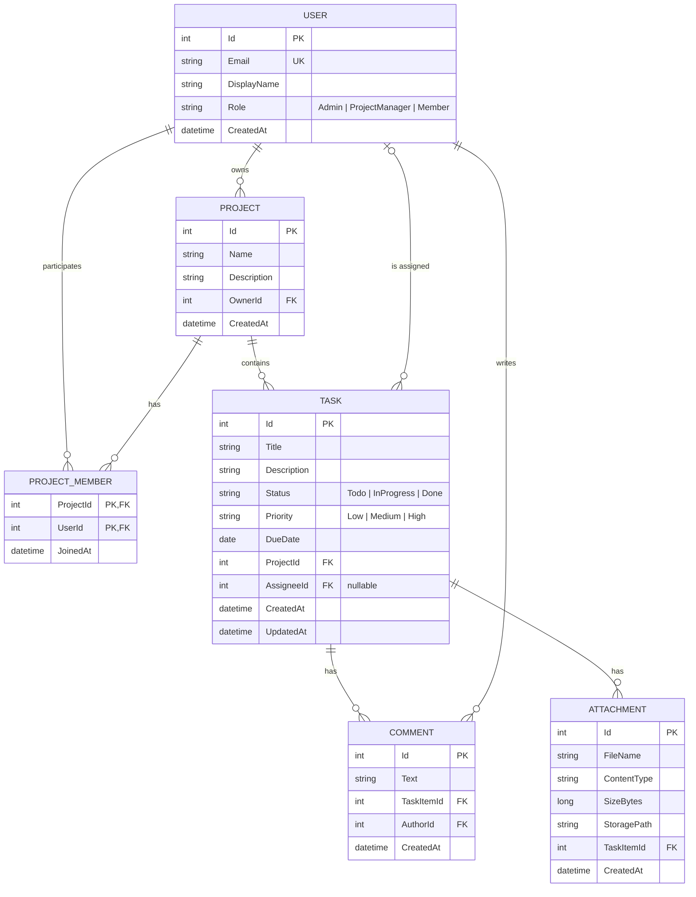

# ER-діаграма (етап 1)

Тема проєкту: **3.2. Система керування задачами (трекер задач)**.
Діаграма у форматі Mermaid — відображається автоматично на GitHub/GitLab та в VS Code (розширення «Markdown Preview Mermaid Support»).

## Правила видалення

| Зв'язок | Поведінка |
|---|---|
| Project → Task, Task → Comment, Task → Attachment, Project → ProjectMember | Cascade |
| User → Task (виконавець) | SetNull |
| User → Project (власник), User → Comment (автор) | Restrict |
